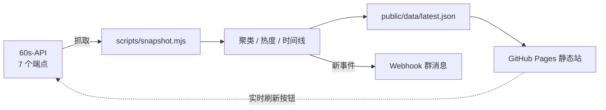

# 热点雷达 Hot Radar

把微博、百度、头条、抖音、知乎的热榜做跨平台聚合：**只有一个事件在多个平台同时上榜，才算全网热点**。每天 60 秒新闻作为定场内容放在侧栏。

数据源为 [60s-API](https://github.com/vikiboss/60s) 的公共实例 `https://news.ucac.edu.kg`（返回 `Access-Control-Allow-Origin: *`，浏览器可直连）。

## 为什么不只是又一个热榜页

单平台热榜到处都是，缺的是「共识」这一层：同一件事在几个平台同时出现、各自排第几、已经在榜多久。本项目只做这一层，其余一律跳转原页面。

## 工作方式



`src/lib/radar.js` 是纯函数核心，Node 定时任务和浏览器共用同一份聚类逻辑，所以「实时刷新」和「定时快照」算出来的结果一致。

### 聚类

1. **归一化**：去标点与空白、全角转半角、`两名/2名` 这类中文数字按量词转阿拉伯数字。
2. **两条相似通路**（都必须先过长度比闸门 `min/max ≥ 0.55`）：
   - 字 3-gram 命中率 `≥ 0.5` —— 覆盖同题不同措辞；
   - 字袋重合 `≥ 0.8` 且最长公共子序列占比 `≥ 0.7` —— 覆盖同词不同语序（如「无锡队夺得苏超冠军」/「无锡队苏超夺冠」）。
   长度比闸门是必需的，否则「微博视界大会座位」会被并进「…微博视界大会同台领奖」。
3. **只在不同平台之间连边**：同平台两条热搜彼此无关，连边只会制造假合并。

### 热度

榜内 `log(1+hot)` 做 min-max 归一化（无热度值的榜单退化为排名分）× 平台权重（微博/百度 1.0、头条 0.95、抖音 0.9、知乎 0.85），簇内取最大值，再乘 `1 + 0.12 × (平台数 - 1)` 的共识加成，最后按当前最大值缩放成 0–100。

### 时间线

每次快照把当前簇与上一轮的故事做相似度匹配，保留 `firstSeen` / 峰值 / 曲线；断档超过 90 分钟视为重新上榜，重置起点。故事与曲线保留 48 小时，快照里最多 48 个点。

## 数据结构

`public/data/latest.json`：

| 字段 | 说明 |
|---|---|
| `capturedAt` | 快照时间戳 |
| `digest` | 60 秒日报：`date` / `news[]` / `tip` / `link` |
| `boards[]` | 各榜单：`id` / `label` / `tier`（`hot` 参与聚类、`feed` 只展示）/ `ok` / `stale` / `error` / `items[]` |
| `clusters[]` | 跨平台事件：`title` / `summary`（簇内最长简介，来自百度 desc 或知乎 detail）/ `heat` / `platforms` / `firstSeen` / `series` / `members[]`（含平台、排名、链接） |
| `stories[]` | 48 小时故事时间线，用于曲线与在榜时长 |

## 运行

```bash
npm install
npm run snapshot   # 抓一次上游，生成 public/data/latest.json
npm run dev        # http://localhost:5173
npm run build      # 产物在 dist/
```

页面上的「实时刷新」在浏览器里直接请求上游并用同一套逻辑重算，不需要后端；时间线与历史则依赖定时快照。

## 目录

```
src/lib/radar.js         纯函数核心：归一化、相似度、聚类、热度、时间线（Node 与浏览器共用）
scripts/snapshot.mjs     定时任务：抓取 → 聚类 → 写快照 → 推送
scripts/notify.mjs       Webhook：格式适配、推送闸门、去重
src/lib/live.ts          浏览器端实时抓取
src/components/          共识榜 / 平台热榜 / 60 秒日报
public/data/latest.json  当前快照 + 48 小时故事时间线（由 Actions 提交）
state/notified.json      推送去重状态（首次推送后生成）
.github/workflows/       每 30 分钟快照并部署 Pages
```

## 部署

1. 推到 GitHub，**默认分支必须是 `main`**（workflow 里写死了）。
2. Settings → Pages → Source 选 **GitHub Actions**。
3. Settings → Actions → General → Workflow permissions 选 **Read and write**（机器人要提交快照）。
4. Actions → refresh → Run workflow 跑一次建立基线（不勾 bootstrap），之后每 30 分钟自动执行。
5. 站点在 `https://<用户名>.github.io/<仓库名>/`。

流程是：抓取 → 提交 `public/data/latest.json` → 构建 → 部署。首次如果 Pages 还没启用，部署步骤会失败，启用后重跑一次即可。

## Webhook 推送

部署后可以把「新出现的跨平台热点」推到群里。推送发生在 GitHub Actions 里（服务端），浏览器端永远不接触 webhook URL——那是凭据，且多数服务端 webhook 不允许跨域。

1. Settings → Secrets and variables → Actions → New repository secret：`WEBHOOK_URL`。
2. （可选）同页 Variables 配置下表里的调参项。
3. Actions → refresh → Run workflow：不勾 bootstrap 建立基线，勾上则立刻推一次用于验证。

按域名自动选格式：`oapi.dingtalk.com` → 钉钉 markdown `[标题](链接)`，`open.feishu.cn` / `larksuite.com` → 飞书富文本卡片（`post`，标题是 `a` 标签），`qyapi.weixin.qq.com` → 企业微信 markdown，`discord.com` → Discord 掩码链接，`hooks.slack.com` → Slack `<链接|标题>`，其余通用 JSON `{ title, text, markdown, clusters }`。

### 消息内容

每条事件包含：标题（**本身即超链接**，不出现裸 URL）、≤120 字摘要（与站点一致，取自百度 `desc` / 知乎 `detail`）、平台角标与热度。当天第一条消息末尾再附 60 秒日报，`阅读原文` 同样是掩码链接。

### 长度与降级

各平台单条上限：钉钉 18KB、企业微信 4KB、Discord 1900 字、飞书/Slack 基本无感。超限时按顺序降级，绝不静默丢内容：

1. 去掉摘要（标题、平台、日报全部保留）；
2. 仍超限就拆成「热点」「日报」两条消息；
3. 单条还是放不下才按行截断，并在末尾标注「已截断，完整内容见站点」。

所以 8 点那批隔夜热点较多时，企业微信/Discord 可能收到两条消息，日报不会被挤掉。发送多条的场合，只要有一条失败就不标记已读，下一轮整体重发。

### 推送节奏（北京时间）

| 时间 | 行为 |
|---|---|
| 08:00 | 推 0 点至今的新事件（含昨晚 22:00 之后的积压） |
| 09:00–22:00 | 每小时推一次期间新出现的事件 |
| 22:00 之后 | 不推送，攒到次日 08:00 一起发 |

当天第一次推送会在末尾附上**当日 60 秒日报**（15 条摘要 + 一句 tip + 原文链接）。以 `digest.date === 今天` 为准：如果 08:00 时上游还没更新到当天，就顺延到下一次推送补上，当天只发一次；即使那段时间没有新热点，也会单独发一条日报。

不是靠精确 cron，而是「窗口 + 最小间隔」：快照仍每 30 分钟跑一次，推送闸门检查当前小时是否落在窗口内、距上次推送是否已过 `PUSH_MIN_GAP` 分钟。Actions 的定时任务经常延迟几分钟甚至丢跑，这样即使 08:00 那次跑到 08:12 也无影响，丢跑的那轮由下一次补上。

### 去重与排队

- 同一故事 id 不重复推；事件掉榜后重新上榜会拿到新 id，再用 **24 小时内标题相似度**兜住，不会二次推送。
- 去重状态在 `state/notified.json`，随快照一起提交，跨机器重启保留（id 记 7 天、标题记 48 小时）。
- 单条最多推 `WEBHOOK_MAX_ITEMS`（默认 10）条，超出的**留在队列**下一小时继续发，不会丢。
- 首次部署静默记账，不刷屏。
- 发送失败只打日志、不记账，下一轮重试，不影响快照与部署。

| 变量 | 默认 | 说明 |
|---|---|---|
| `WEBHOOK_URL` | — | 机器人地址（Secret） |
| `WEBHOOK_MIN_HEAT` | 60 | 热度门槛，低于此值只上站不推送 |
| `WEBHOOK_MAX_ITEMS` | 10 | 单条消息最多几条事件 |
| `PUSH_TZ` | `Asia/Shanghai` | 计算「几点」用的时区 |
| `PUSH_START_HOUR` | 8 | 推送窗口起点 |
| `PUSH_END_HOUR` | 22 | 推送窗口终点 |
| `PUSH_MIN_GAP` | 55 | 两次推送的最小间隔（分钟） |
| `WEBHOOK_BOOTSTRAP` | 关闭 | `1` 时跳过首次静默，立即推送 |
| `API_BASE` | 公共实例 | 抓取用的上游地址 |
| `VITE_API_BASE` | 公共实例 | 前端实时刷新用的上游地址 |

## 运维

- **仓库会持续变大**：每次快照约 92KB（压缩后 10–15KB），每天 48 次，一年约 200MB。半年左右可清一次历史，只保留最新快照：

  ```bash
  git checkout --orphan clean && git add -A && git commit -m "snapshot reset"
  git branch -D main && git branch -m main && git push -f origin main
  ```

- **Actions 定时任务不准时**：延迟 5–15 分钟正常，偶尔整轮丢跑。推送逻辑已按「窗口 + 最小间隔」设计以容忍这两种情况；快照丢跑只影响那半小时的曲线点。
- **仓库 60 天无活动会被停用定时任务**：本项目每 30 分钟提交快照，属于活动，正常不会触发；若关掉提交步骤需自行留意。

## 数据源故障与备用方案

页面是纯静态的：上游挂了，GitHub Pages 照常打开，展示最后一次成功构建的快照。抓取侧的兜底分三层。

**1. 多实例故障转移（默认开启）**

`API_BASE` 支持逗号分隔的列表，默认 `https://news.ucac.edu.kg,https://60s.viki.moe`。每个请求按顺序试，第一个可用实例会被记住，同一次运行内不再来回切；遇到 429 限流同样会跳到下一个。前端「实时刷新」用相同的策略，变量是 `VITE_API_BASE`。

**2. 沿用旧快照**

所有实例都失败时，各榜单沿用仓库里上一份 `latest.json` 的条目并标记 `stale: true`，页面顶部列出异常源；共识榜继续显示上一次的结果，**但时间线不再延伸**（否则会谎报「在榜 N 小时」），推送因为「没有新事件」自然停止。因为快照本身在仓库里，这条兜底不依赖任何外部服务。

**3. 自建实例**

60s-API 是开源的（Deno / Node 均可部署）。自建后把 `API_BASE` 与 `VITE_API_BASE` 指向自己的域名即可，代码无需改动。

长期不可用时的恢复路径：仓库里的 `latest.json` 就是最后一版可用数据；换一个可用实例或自建地址，下一次 cron 自动恢复。

## 健壮性

- 任一榜单失败不会阻塞整体：该榜单沿用上一份快照并标记 `stale`，页面顶部会点出异常源。
- 60 秒日报失败时沿用上次内容。

## 限制

- 只对中文标题做聚类；IT 之家、Hacker News 作为独立榜单展示，不参与共识计算。
- 上游只提供标题与链接，站内不聚合正文，所有条目一律跳转原始页面。
- 热度是相对值，不是绝对热度，跨平台比较仅有排序意义。
